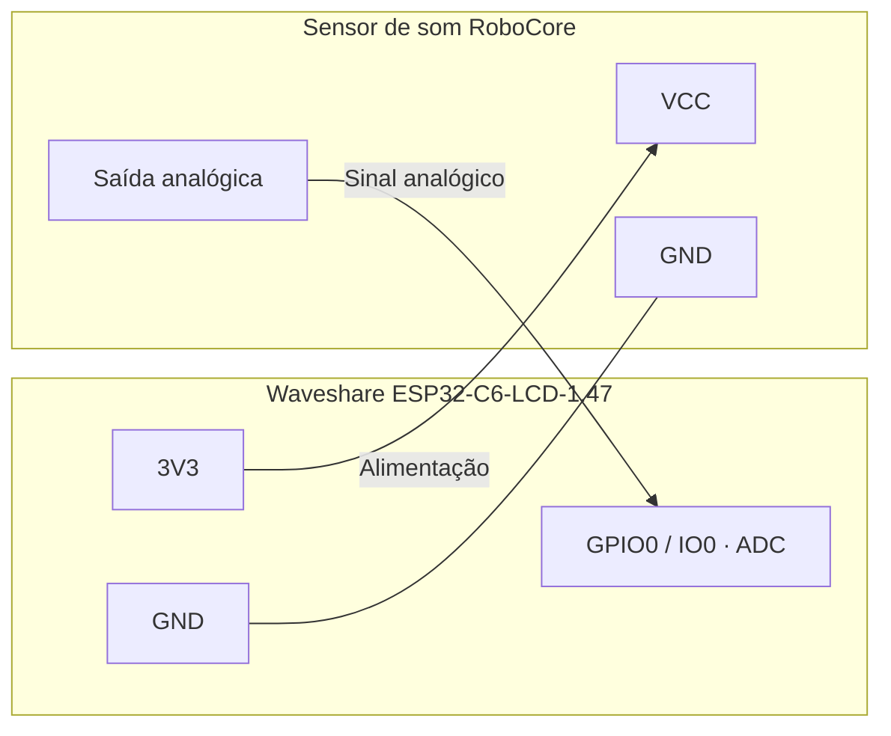
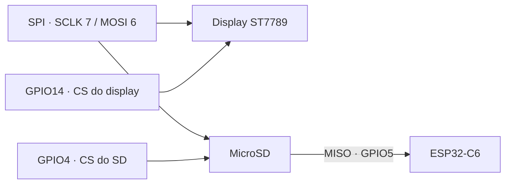

# Pinout — ESP32-C6 Gateway

**Revisão: 02/11/2026** · [Início](README.md) · [Operação](LEIA-ME.md) · [Comandos](COMANDOS.md) · [Prometheus](PROMETHEUS.md)

Guia de ligação da **Waveshare ESP32-C6-LCD-1.47**, com display ST7789 de
172 × 320 pixels, cartão microSD, LED RGB e sensor analógico de som RoboCore.
Os números deste documento são **GPIOs do ESP32**, não posições físicas do
conector. Na placa, `GPIO0` pode estar identificado como `IO0`.

> [!IMPORTANT]
> Esta pinagem é a do modelo **ESP32-C6-LCD-1.47 sem Touch** usado pelo projeto.
> A variante Touch tem outra pinagem. Confira o nome da placa e a identificação
> dos pinos antes de ligar periféricos. Faça as conexões com a placa desligada.

## Mapa consolidado do projeto

| Recurso | Sinal | GPIO | Direção no ESP32 | Uso |
| :--- | :--- | :---: | :--- | :--- |
| Sensor de som RoboCore | Saída analógica do módulo | **0** | Entrada ADC | Nível relativo de som e gráfico na página 10 |
| SPI compartilhado | SCLK | **7** | Saída | Clock do display e do microSD |
| SPI compartilhado | MOSI | **6** | Saída | Dados para display e microSD |
| MicroSD | MISO | **5** | Entrada | Dados vindos do cartão |
| MicroSD | CS | **4** | Saída | Seleção do cartão, ativo em nível baixo |
| Display ST7789 | CS | **14** | Saída | Seleção do display, ativo em nível baixo |
| Display ST7789 | DC | **15** | Saída | Seleção entre comando e dados |
| Display ST7789 | RESET | **21** | Saída | Reset do display |
| Display ST7789 | BL | **22** | Saída PWM | Controle de brilho do backlight |
| LED RGB integrado | DATA | **8** | Saída | Controle pelo módulo `RGBLed` |
| Botão BOOT integrado | Botão | **9** | Entrada com pull-up | Pressionado em nível baixo |

Display, microSD, LED RGB e botão já fazem parte da placa. **Não precisam de
novos jumpers** para as conexões internas listadas acima.

## Ligação do sensor de som RoboCore

O projeto foi preparado para o [Sensor de Som analógico da RoboCore](https://www.robocore.net/sensor-ambiente/sensor-de-som-microfone),
que usa microfone e amplificador. Use a identificação dos terminais no seu
módulo; a saída pode ser identificada como sinal analógico.

| Terminal do sensor | Ligar na placa | Observação |
| :--- | :--- | :--- |
| **VCC / alimentação positiva** | **3V3** | Alimentação em 3,3 V nesta ligação |
| **GND / terra** | **GND** | Terra comum com o ESP32 |
| **Saída analógica de sinal** | **GPIO0 / IO0** | Entrada ADC usada pelo firmware |



> [!WARNING]
> O módulo aceita mais de uma tensão de alimentação, mas nesta ligação direta
> use **3V3**, não 5 V. Não aplique um sinal de 5 V ao GPIO do ESP32.
> Se o seu módulo tiver apenas saída digital ou interface I2S, essa ligação
> e esse adaptador analógico não se aplicam.

### Configuração no firmware

Em [SoundMonitor.h](SoundMonitor.h):

```cpp
namespace SoundSensorConfig { constexpr int ANALOG_PIN = 0; }
```

Use `ANALOG_PIN = -1` para desativar a captação quando o sensor não estiver
conectado. Um pino analógico solto pode produzir valores sem significado;
o firmware não detecta automaticamente a presença física do módulo.

O adaptador aceita **GPIO0 a GPIO3** nesta placa, preservando os pinos do SPI.
Se mudar o sinal para outro desses GPIOs, atualize a constante e a ligação.
Não remapeie display ou SD para acomodar o sensor.

### Como visualizar

Envie `tela:10` pela serial ou por UDP, ou navegue pelo botão BOOT.

- A leitura começa na inicialização e continua em tarefa própria, inclusive fora da página.
- Por padrão, a tela mostra um **equalizador de 12 faixas**, de aproximadamente **80 Hz a 10 kHz**, com barras segmentadas e retenção de pico.
- A captação usa **ADC contínuo/DMA a 20 kHz**, FFT de **512 amostras**, remoção de DC e janela Hann. A resolução é aproximadamente **39 Hz**.
- O ganho visual começa em **32x**. Ajuste com `som_ganho:1` até `som_ganho:64`; sons fracos e ruído são realçados juntos. O equalizador também usa compressão visual.
- `som_modo:historico` mostra os últimos **9,6 segundos**, com até **96 pontos** de amplitude pico a pico. `som_modo:equalizador` retorna às frequências.
- A atualização visual é aproximadamente a cada **100 ms**; ganho e modo não são persistidos no reboot.
- `ADC SATURADO` indica amostras nos limites da entrada. Ganho visual não muda a tensão, não recupera sinal saturado e não representa decibéis.
- A página permanece aberta, sem retorno automático ao relógio nem protetor; a redução de brilho continua ativa.
- Use BOOT, `tela_next` ou `tela:N` para sair.

Não é uma gravação de áudio, um osciloscópio de áudio nem uma medição calibrada
de pressão sonora. Não há métricas Prometheus de som implementadas nesta revisão.
O ADC contínuo assume o ADC1; não use `analogRead` em outro canal dessa unidade
ao mesmo tempo sem adaptar o driver. Não é necessária biblioteca FFT externa.

## Display e microSD no mesmo SPI



O display usa **DC 15**, **RESET 21**, **BL 22** e offset horizontal de
**34 pixels**. As páginas são apresentadas em orientação paisagem.

O SD é iniciado antes do display. [SharedSpi.h](SharedSpi.h) usa um mutex
recursivo para coordenar display, cartão e desenhos da OTA; os CS ficam
desativados em nível alto entre operações. GPIO4, 5, 6 e 7 não devem ser
reutilizados para o sensor de som.

## Pinos reservados e interfaces

| Pinos | Situação nesta revisão |
| :--- | :--- |
| **GPIO0** | Sensor de som configurado por padrão |
| **GPIO1, GPIO2 e GPIO3** | Não utilizados pelos fontes ativos; alternativas aceitas pelo adaptador analógico |
| **GPIO4 a GPIO9, GPIO14, GPIO15, GPIO21 e GPIO22** | Ocupados pelas funções da tabela principal |
| **GPIO12 e GPIO13** | USB nativo do ESP32-C6; preservar para o console e gravação USB |
| **GPIO16 e GPIO17** | Interface UART0 do chip; não são o console USB CDC configurado por padrão |
| Outros pinos expostos | Fora do mapa funcional deste firmware; conferir esquema e restrições antes de usar |

O botão BOOT também participa do modo de gravação. O uso em GPIO9 permanece
o do botão integrado; não conecte o sensor nesse pino.

## Portas de comunicação — não são GPIOs

| Interface | Configuração |
| :--- | :--- |
| Serial USB CDC | **115200 baud**, final de linha CR, LF ou CRLF |
| Console UDP | **4210** |
| Portal HTTP | **80** |
| Prometheus `/metrics` | **9120 por padrão**, configurável em `/prometheus` |
| OTA | ArduinoOTA após conexão Wi-Fi; hostname `ESP32-C6-Gateway` |

Detalhes: [COMANDOS.md](COMANDOS.md), [PROMETHEUS.md](PROMETHEUS.md) e
[guia operacional](LEIA-ME.md).

## Diagnóstico da ligação

| Sintoma | Conferência inicial |
| :--- | :--- |
| Som sem sinal ou valores aleatórios | VCC em 3V3, GND comum, sinal em GPIO0 e módulo conectado |
| Mensagem de sensor desativado | Verificar se `ANALOG_PIN` está em `-1` |
| Falha ao iniciar o sensor | Consultar `SOUND_START_FAILED` no diagnóstico e memória disponível |
| Gráfico sem atualização | Abrir `tela:10` e conferir a captação; não confundir nível relativo com dB |
| SD não responde ao CMD0 | Conferir encaixe e usar o [sketch isolado](diagnosticos/SD_SPI_Diagnostico/LEIA-ME.md) |
| Display ou SD falham após conectar o sensor | Conferir se GPIO4..7, alimentação ou CS foram usados por engano |

## Fontes e arquivos de referência

- [Placa Waveshare](https://docs.waveshare.com/ESP32-C6-LCD-1.47) e [esquema elétrico](https://files.waveshare.com/wiki/ESP32-C6-LCD-1.47/ESP32-C6-LCD-1.47_schemetics.pdf).
- [Sensor de som RoboCore](https://www.robocore.net/sensor-ambiente/sensor-de-som-microfone).
- [GPIO e ADC do ESP32-C6 — Espressif](https://docs.espressif.com/projects/esp-idf/en/latest/esp32c6/api-reference/peripherals/gpio.html).
- [SoundMonitor.h](SoundMonitor.h), [SoundMonitor.cpp](SoundMonitor.cpp), [DisplayUtil.cpp](DisplayUtil.cpp), [SDUtil.h](SDUtil.h), [RGBLed.h](RGBLed.h) e [ESP32C6.ino](ESP32C6.ino).

Revisão documental a partir dos fontes. A ligação e o comportamento do sensor
precisam ser verificados na placa; este guia não implica teste físico realizado.
