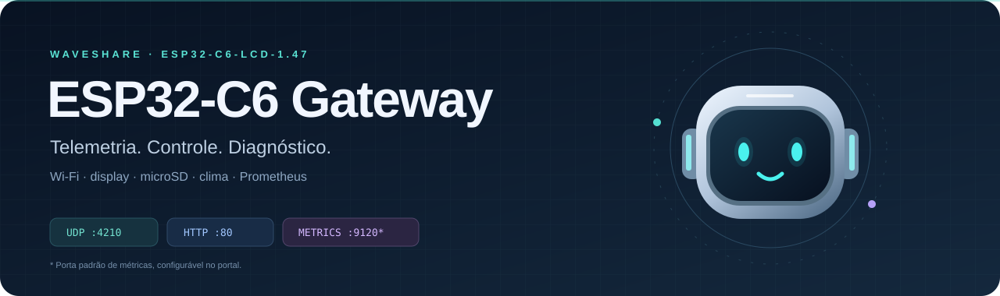
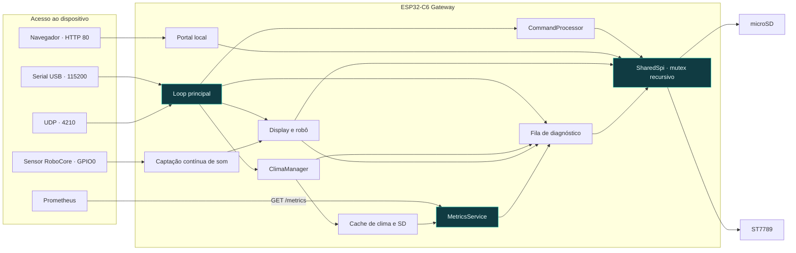
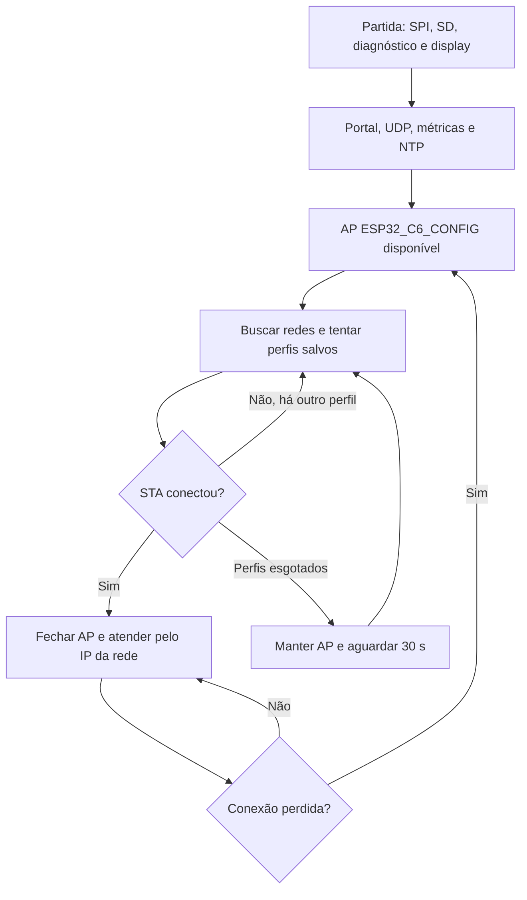
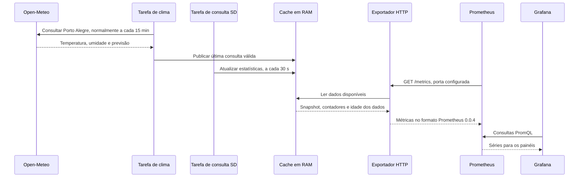
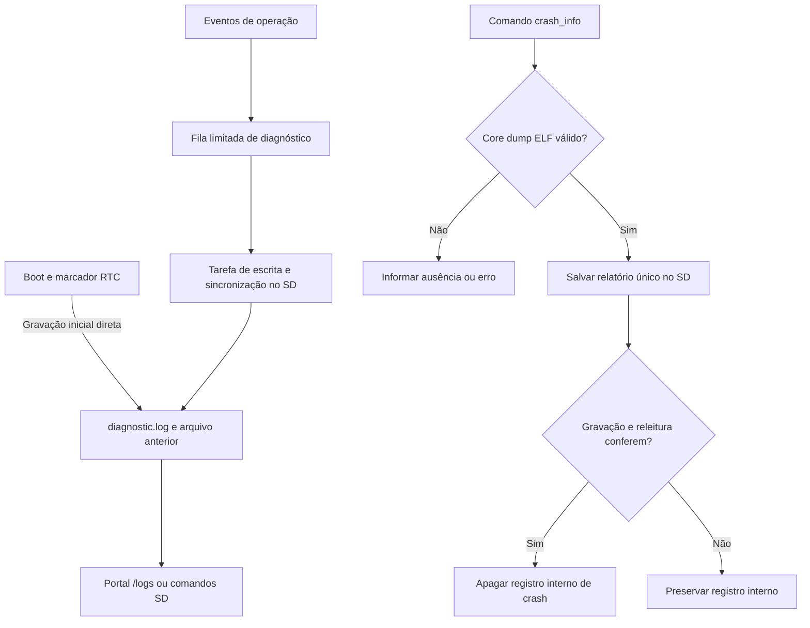

<div align="center">



# ESP32-C6 Gateway

**Um painel de operações na palma da mão.**

Firmware para a **Waveshare ESP32-C6-LCD-1.47**, com portal local, consoles serial/UDP,
logs no microSD, clima de Porto Alegre e métricas para Prometheus e Grafana.

Documentação revisada em **02/11/2026** · [Pinout e ligações](PINOUT.md)

[](#hardware)
[](#primeiros-passos)
[](#arquitetura)
[](#interface)
[](#observabilidade)
[](#comandos)
[](#comandos)

[Começar](#primeiros-passos) · [Arquitetura](#arquitetura) · [Portal](#portal) · [Métricas](#observabilidade) · [Diagnóstico](#diagnostico) · [Documentação](#documentacao)

</div>

---

## O que este firmware entrega

| Conectar | Acompanhar | Investigar |
| :--- | :--- | :--- |
| Cinco perfis Wi-Fi e AP de configuração | Relógio, clima e onze páginas no display | Logs de comandos, rede e diagnóstico no SD |
| Comandos por serial USB e UDP | Ping ao gateway e histórico de latência | Memória, reinícios e duração das consultas HTTP |
| Portal local e atualização OTA | Exportador Prometheus e integração com Grafana | Consulta de core dump com `crash_info` |

O display também tem um **robô animado com dez expressões coloridas**: ele pisca,
se movimenta e rebate nas bordas durante a inatividade. A tela permanece ligada.

<a id="primeiros-passos"></a>
## Primeiros passos

### 1. Preparar e gravar

| Requisito | Configuração |
| :--- | :--- |
| Placa | Waveshare **ESP32-C6-LCD-1.47**, com ST7789 |
| Core Arduino | **esp32 by Espressif Systems 3.x** |
| Bibliotecas | **Arduino_GFX_Library**, **Adafruit NeoPixel**, **SdFat 2.x** |
| Ferramentas | Arduino IDE 2 ou Arduino CLI com as tarefas do VS Code |
| Serial USB | **115200 baud**, final de linha CR, LF ou CRLF |

Abra [ESP32C6.ino](ESP32C6.ino), selecione a placa e a porta USB reais, habilite
**USB CDC On Boot** para o console USB nativo e use uma partição compatível com OTA.
Compile e grave. Flash, opções USB e partições devem corresponder à placa física.

<details>
<summary><strong>Usar as tarefas do VS Code</strong></summary>

As tarefas estão em [.vscode/tasks.json](.vscode/tasks.json) e usam
[.vscode/arduino.ps1](.vscode/arduino.ps1).

| Ação | Tarefa |
| :--- | :--- |
| Compilar | `ESP32C6: Compilar` — também por **Ctrl+Shift+B** |
| Identificar a placa USB | `ESP32C6: Listar portas` |
| Compilar e gravar | `ESP32C6: Compilar e gravar USB` |
| Abrir o console | `ESP32C6: Monitor serial` |

FQBN sugerido pelas tarefas: `esp32:esp32:esp32c6:CDCOnBoot=cdc`.
Informe a porta `COM` correta e encerre o monitor antes de gravar.
Os artefatos ficam em `.build/`. As tarefas não instalam cores ou bibliotecas.

[Guia detalhado de compilação e gravação](LEIA-ME.md#compilar-e-gravar-pelo-vs-code).

</details>

### 2. Conectar à rede

Na partida, conecte-se ao AP **`ESP32_C6_CONFIG`** e abra
[192.168.4.1/wifi](http://192.168.4.1/wifi). Cadastre até cinco redes e salve.
O firmware verifica a gravação antes de reiniciar. Após a conexão, use o IP da
placa na sua rede para acessar o portal.

### 3. Confirmar a operação

Envie estes comandos pelo console serial ou por UDP:

```text
help
status
wifi_list
sd_status
clima
```

Depois, abra `/prometheus` no portal, configure o exportador e baixe o YAML
para adicionar o alvo ao seu servidor Prometheus.

<a id="arquitetura"></a>
## Arquitetura

O loop principal coordena a interface, os comandos e os serviços de rede.
Clima, captação de som, consultas do SD e escrita de diagnóstico têm tarefas próprias.
Display, cartão e desenhos da OTA compartilham uma proteção de acesso ao SPI.



### Fluxo de conexão Wi-Fi

O AP fica disponível durante a busca. As tentativas dos perfis são controladas
por estados, com até **10 segundos por rede** e nova rodada após **30 segundos**.



<a id="portal"></a>
## Portal local

Interface independente de fontes, scripts e estilos externos, acessível pelo
navegador na **porta 80**.

| Rota | Uso |
| :--- | :--- |
| `/info` | Informações do dispositivo e da conexão |
| `/wifi` | Cadastro e edição dos cinco perfis Wi-Fi |
| `/logs` | Visualização dos logs do cartão, com atualização automática |
| `/prometheus` | Preferências do exportador de métricas |
| `/prometheus.yml` | Download da configuração sugerida de coleta |

O endpoint `/metrics` usa a porta configurada, **9120 por padrão**. Se ela for
alterada para 80, ele compartilha o servidor do portal.

<a id="observabilidade"></a>
## Prometheus e Grafana

**Coleta por HTTP pull:** o servidor Prometheus consulta o ESP32. As preferências
ficam em NVS; salvar o formulário na placa não altera o servidor Prometheus.



| Área | Exemplos de métricas |
| :--- | :--- |
| Identificação | `esp_info`, `esp_firmware_version`, `esp_ip_address` |
| Recursos | `esp_heap_free_bytes`, `esp_cpu_usage_percent`, `esp_cpu_temperature_celsius` |
| UDP | `esp_udp_listener_up`, `esp_udp_packets_received_total`, `esp_udp_send_errors_total` |
| Cartão e logs | `sdcard_mounted`, `sdcard_log_records_total`, `sdcard_log_errors_total` |
| Clima de Porto Alegre | `sensor_temperature_celsius`, `sensor_humidity_percent`, `esp_weather_data_age_seconds` |

As métricas de clima usam `source="open_meteo"` e `location="porto_alegre"`.
A temperatura interna do chip é uma série separada. Todas as séries incluem
o label `device`, com o MAC STA, para correlacionar os painéis.

<details>
<summary><strong>Exemplo de configuração do Prometheus</strong></summary>

Substitua o endereço e a porta pelos valores da sua placa:

```yaml
scrape_configs:
  - job_name: esp32_c6
    scrape_interval: 15s
    metrics_path: /metrics
    static_configs:
      - targets: ['192.168.1.42:9120']
```

Se `scrape_configs` já existir, adicione apenas o job à lista.

```promql
# Taxa de registros de log gravados por segundo
rate(sdcard_log_records_total[5m])

# Erros de envio UDP nos últimos cinco minutos
increase(esp_udp_send_errors_total[5m])

# Temperatura de Porto Alegre
sensor_temperature_celsius{source="open_meteo",location="porto_alegre"}
```

</details>

**[Catálogo completo, labels e limites de interpretação → PROMETHEUS.md](PROMETHEUS.md)**

<a id="comandos"></a>
## Comandos: serial e UDP

Os dois transportes usam o mesmo processador de comandos, com limite de
**255 bytes** por entrada. O comando `help` retorna `COMANDOS` e um comando por
linha, em formato apropriado para leitura automática.

```mermaid
sequenceDiagram
    participant Cliente as Cliente serial ou UDP
    participant Loop as Loop principal
    participant Comando as CommandProcessor
    participant Servico as Serviço solicitado
    Cliente->>Loop: Comando de texto
    Loop->>Comando: Normalizar nome e preservar argumentos
    Comando->>Servico: Validar parâmetros e executar
    Servico-->>Comando: Resultado
    alt Comando recebido pela serial
        Comando-->>Cliente: Resposta no console serial
    else Comando recebido por UDP
        Comando-->>Cliente: Resposta serial e ao cliente UDP
    end
```

| Objetivo | Comandos úteis |
| :--- | :--- |
| Identificação e recursos | `info`, `status`, `version`, `ram`, `uptime` |
| Redes e monitoramento | `wifi_list`, `net_info`, `net_monitor`, `net_history` |
| Arquivos e cartão | `sd_status`, `sd_list:/`, `sd_read:/diagnostic.log` |
| Clima | `clima`, `clima_age`, `clima_sync` |
| Tela | `tela:7`, `tela_next`, `brilho:40` |
| Investigação de falhas | `reason`, `crash_info` |

**[Sintaxe, argumentos e exemplos → COMANDOS.md](COMANDOS.md)**

<a id="interface"></a>
## Display, botão e proteção de tela

| Página | Conteúdo | Página | Conteúdo |
| :---: | :--- | :---: | :--- |
| 0 | Relógio, clima e Wi-Fi | 5 | Sistema |
| 1–2 | NTP e serviços | 6 | Perfis Wi-Fi |
| 3–4 | Rede | 7 | Cartão SD |
| 8 | Monitor de rede e latência | 9 | Previsão diária |
| 10 | Monitor de som com gráfico e pico | — | — |

O monitor de som (`tela:10`) usa o sensor analogico RoboCore no **GPIO0**, com
VCC em **3V3** e GND comum. A captacao continua usa ADC/DMA e FFT para mostrar
um **equalizador de 12 faixas**. O ganho visual padrao e **32x**, ajustavel com
`som_ganho:1..64`. Use `som_modo:historico` para acompanhar os ultimos **9,6 segundos**
ou `som_modo:equalizador` para retornar as frequencias. A pagina permanece aberta.
A escala e visual, sem medicao em decibeis. Veja a
[ligacao e os detalhes de leitura](COMANDOS.md#páginas) antes de conectar.

| Ação no BOOT | Resultado |
| :--- | :--- |
| Pressão curta | Próxima página |
| Segurar por 3 segundos e soltar | Reiniciar |
| Segurar por 10 segundos e soltar | Limpar redes salvas e reiniciar |

Nas demais páginas, após **60 segundos de inatividade**, entra o robô animado. As expressões mudam
a cada **4,2 segundos**. Após **2 minutos**, o brilho cai para no máximo 20%,
sem desligar automaticamente a tela. Botão ou comando encerram a proteção.
O brilho padrão é 80%; `tela_off` e `brilho:0` continuam disponíveis para desligamento manual.

<a id="diagnostico"></a>
## Diagnóstico que continua no cartão

Em `/logs`, escolha o arquivo e acompanhe o trecho mais recente, com atualização
automática a cada cinco segundos e limite de **8 KiB por consulta**.

| Arquivo no SD | Conteúdo | Rotação |
| :--- | :--- | :--- |
| `/log.txt` | Registros do console de comandos | Sem rotação automática nesta rotina |
| `/network_history.log` | Conexão, quedas e amostras de ping | Arquivo anterior a partir de aproximadamente 64 KiB |
| `/diagnostic.log` | Boot, memória, Wi-Fi, animação, clima e consultas de métricas | Arquivo anterior a partir de 256 KiB |
| `/crash_*.txt` | Relatórios arquivados por `crash_info` | Nomes únicos, sem sobrescrever relatórios anteriores |

Os arquivos anteriores de rede e diagnóstico usam o sufixo `.previous.log`.
Os relatórios `crash_*.txt` podem ser listados e lidos pelos comandos SD;
o seletor web oferece os logs de comandos, rede e diagnóstico.



`METRICS_START`, `METRICS_RENDERED` e `METRICS_END` ajudam a localizar interrupções.
`WEATHER_START` e `WEATHER_END` permitem comparar memória entre consultas do clima.
Um marcador RTC pode registrar uma consulta interrompida após reset; ele não garante
recuperação após perda de alimentação. O retorno do envio HTTP não comprova que
o Prometheus recebeu a resposta completa.

O comando `crash_info` requer core dump ELF em flash e partição compatível.
No C6, o relatório contém registradores e pilha **RISC-V**, para análise com
o ELF correspondente ao firmware gravado.

<a id="hardware"></a>
## Hardware e SPI compartilhado

Pinagem da **Waveshare ESP32-C6-LCD-1.47** usada neste projeto:

| Recurso | GPIO | Recurso | GPIO |
| :--- | :---: | :--- | :---: |
| SPI SCLK | 7 | TFT CS | 14 |
| SPI MOSI | 6 | TFT DC | 15 |
| SD MISO | 5 | TFT reset | 21 |
| SD CS | 4 | TFT backlight | 22 |
| LED RGB | 8 | Botão BOOT | 9 |
| Sensor de som RoboCore | 0 | — | — |

Alimentação do sensor externo: **3V3 e GND**. Esses terminais não são GPIOs.

**[Pinout completo, ligação do sensor e diagrama SPI → PINOUT.md](PINOUT.md)**

O ST7789 usa offset de **34 pixels** e orientação paisagem nas páginas.
O SD é inicializado antes do display. O mutex recursivo de [SharedSpi.h](SharedSpi.h)
coordena os acessos; consultas FAT16/FAT32 liberam o barramento entre blocos.
Uma operação lenta no cartão ainda pode atrasar a interface.

> [!IMPORTANT]
> Esta pinagem corresponde ao modelo **ESP32-C6-LCD-1.47**, não à variante Touch
> nem a placas ESP32-C3. Confira o modelo físico antes de adaptar os pinos.

<a id="documentacao"></a>
## Mapa da documentação

| Documento | Quando usar |
| :--- | :--- |
| [PINOUT.md](PINOUT.md) | GPIOs, alimentação, sensor RoboCore e barramento SPI |
| [LEIA-ME.md](LEIA-ME.md) | Instalação detalhada, configuração e operação |
| [COMANDOS.md](COMANDOS.md) | Referência completa de comandos serial/UDP |
| [PROMETHEUS.md](PROMETHEUS.md) | Métricas, configuração da coleta e Grafana |
| [CHANGELOG.md](CHANGELOG.md) | Histórico das alterações |
| [Teste SPI isolado](diagnosticos/SD_SPI_Diagnostico/LEIA-ME.md) | Investigar cartão sem resposta ao CMD0 |

<details>
<summary><strong>Mapa dos módulos do firmware</strong></summary>

| Módulo | Responsabilidade |
| :--- | :--- |
| [ESP32C6.ino](ESP32C6.ino) | Inicialização, loop, botão e transições de tela |
| [ESP32Gateway.h](ESP32Gateway.h) | Perfis Wi-Fi, portal, UDP e histórico |
| [CommandProcessor.cpp](CommandProcessor.cpp) | Validação, comandos e respostas |
| [DisplayUtil.cpp](DisplayUtil.cpp) · [RobotScreensaver.h](RobotScreensaver.h) | Páginas, brilho e animações |
| [SoundMonitor.h](SoundMonitor.h) · [SoundMonitor.cpp](SoundMonitor.cpp) | Captação de som contínua e histórico com timestamps |
| [MetricsService.cpp](MetricsService.cpp) | Exportador e configuração Prometheus |
| [NetworkMonitor.cpp](NetworkMonitor.cpp) | Ping assíncrono, latência e quedas |
| [ClimaManager.h](ClimaManager.h) · [NTPUtil.cpp](NTPUtil.cpp) | Clima em cache e sincronização de horário |
| [SDUtil.cpp](SDUtil.cpp) · [SharedSpi.h](SharedSpi.h) | Arquivos, estatísticas e acesso compartilhado ao SPI |
| [Diagnostics.cpp](Diagnostics.cpp) · [CrashDiagnostics.cpp](CrashDiagnostics.cpp) | Diagnóstico persistente e consulta de crashes |
| [PortalUi.h](PortalUi.h) · [LogPortal.h](LogPortal.h) | Interface web e visualização de logs |
| [SerialConsole.h](SerialConsole.h) | Entrada serial por linha |
| [OTAManager.h](OTAManager.h) · [RGBLed.cpp](RGBLed.cpp) | Atualização OTA e sinalização RGB |

Os fontes ativos ficam na raiz. `biblioteca/` contém materiais auxiliares;
`diagnosticos/` contém sketches separados para investigação.

</details>

## Operação e limites

| Situação | Primeiro passo |
| :--- | :--- |
| `/metrics` com timeout ou EOF | Consultar `/logs`, memória disponível, Wi-Fi e eventos de métricas |
| Cartão sem resposta ao CMD0 | Conferir encaixe e modelo; usar o teste SPI isolado antes de alterar o formato |
| Clima ainda sem métricas | Aguardar a primeira consulta válida ou solicitar `clima_sync`; verificar `clima_age` |
| Reinícios ou exceções | Consultar `reason`, diagnóstico e `crash_info`; preservar o ELF do firmware |
| Sem resposta a comandos | Conferir IP, UDP 4210 ou serial a 115200 com final de linha |

> [!NOTE]
> Ping ao gateway não testa acesso à Internet. Os dados meteorológicos são do
> Open-Meteo, não de sensores ambientais locais. O firmware continua operando
> sem SD, mas não consegue persistir logs sem um cartão gravável.

> [!WARNING]
> Portal, UDP e OTA não têm autenticação configurada neste projeto. Use em rede
> confiável. O AP de configuração é aberto e a consulta HTTPS do clima usa
> `setInsecure()`, sem validação de certificado.

### Validação

Os badges acima identificam tecnologias e interfaces, não resultados de CI.
A revisão deste README é documental: não substitui compilação, verificação
do tamanho do firmware e testes na placa. Os PDFs presentes no repositório
são cópias de consulta; os guias Markdown refletem as atualizações nos fontes.

---

<div align="center">

**Conecte. Observe. Investigue.**

[Guia operacional](LEIA-ME.md) · [Comandos](COMANDOS.md) · [Prometheus](PROMETHEUS.md) · [Histórico](CHANGELOG.md)

</div>

