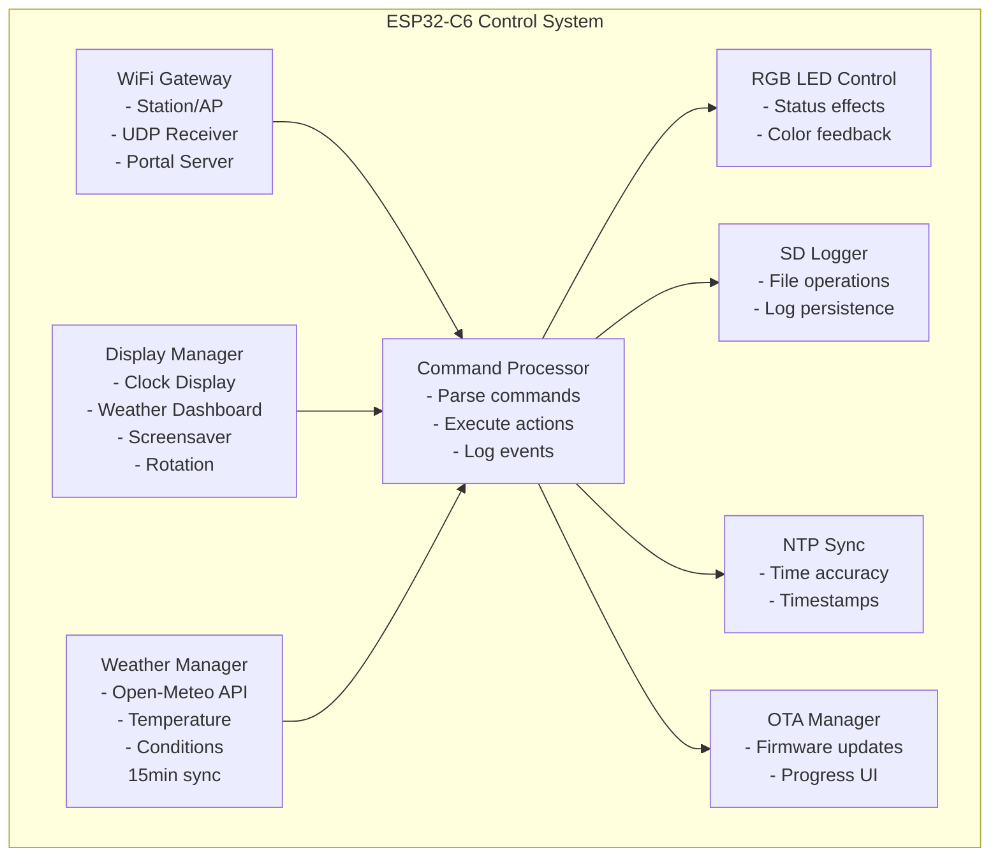
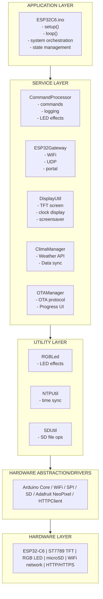
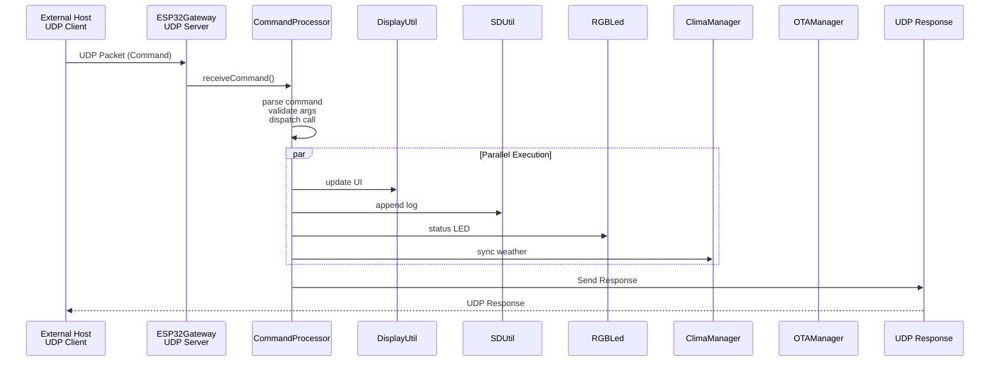
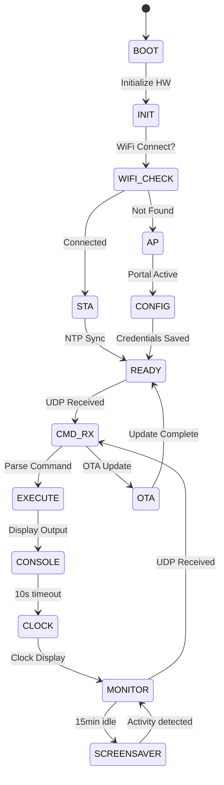

# ESP32-C6 IoT Gateway & Control System

<div align="center">


**A professional-grade IoT gateway system for the ESP32-C6 with WiFi connectivity, real-time ST7789 display, SD card logging, weather integration, OTA updates, and comprehensive UDP command processing.**

</div>

---

## Table of Contents

- [Overview](#overview)
- [Repository-Driven Highlights](#repository-driven-highlights)
- [✨ Key Features](#-key-features)
- [Project Architecture](#project-architecture)
- [System Components](#system-components)
- [Extra Modules & Docs in This Repo](#extra-modules--docs-in-this-repo)
- [Hardware Schematic](#hardware-schematic)
- [Data Flow Diagram](#data-flow-diagram)
- [System State Machine](#system-state-machine)
- [Weather Integration](#-weather-integration)
- [OTA Firmware Updates](#-ota-firmware-updates)
- [Command Reference](#command-reference)
- [Observability (Prometheus)](#observability-prometheus)
- [Diagnostics & Log Portal](#diagnostics--log-portal)
- [Installation & Setup](#installation--setup)
- [Configuration](#configuration)
- [Development](#development)
- [Troubleshooting](#troubleshooting)

---

## Overview

The ESP32-C6 IoT Gateway & Control System is a sophisticated embedded application designed to provide:

- **WiFi Connectivity:** Station and Access Point modes with portal configuration
- **Remote Command Processing:** UDP-based command interface (port 4210)
- **Real-Time Display:** ST7789 TFT with dynamic dashboard and screensaver
- **LED Feedback:** WS2812B RGB LED with effects and status indication
- **Data Logging:** SD card-based persistent logging with timestamps
- **Network Synchronization:** NTP for accurate time synchronization
- **Weather Integration:** Real-time weather data from Open-Meteo API
- **OTA Updates:** Over-The-Air firmware updates with visual progress
- **System Monitoring:** Real-time CPU, RAM, Flash, and climate metrics

## Repository-Driven Highlights

This README was enriched based on files currently present in this repository:

- `COMANDOS.md` / `COMANDOS.pdf`: full operational command catalog and practical command usage.
- `PROMETHEUS.md` / `PROMETHEUS.pdf`: telemetry and metrics contract guidance.
- `CHANGELOG.md`: project evolution timeline and feature history.
- `LEIA-ME.md`: Portuguese companion documentation.
- `Diagnostics.*` + `CrashDiagnostics.*`: runtime diagnosis and crash-analysis flows.
- `LogPortal.h`: local log portal support.
- `RobotScreensaver.h`: dedicated display screensaver module.
- `biblioteca/` and `diagnosticos/`: support assets/documentation directories.

### ✨ Key Features

- ✅ Automatic WiFi connection with fallback to configuration portal
- ✅ **Real-time weather dashboard** with temperature and conditions
- ✅ **OTA firmware updates** with visual progress bar on display
- ✅ UDP command reception and processing (30+ commands)
- ✅ HTML-based WiFi configuration interface
- ✅ Comprehensive system diagnostics and monitoring
- ✅ SD card file management and persistent logging
- ✅ RGB LED visual status indication with effects
- ✅ Clock display with date/time and screensaver (Matrix-style cascade)
- ✅ Advanced command parsing with parameter validation
- ✅ Automatic weather sync every 15 minutes (Open-Meteo API)
- ✅ System responsiveness with command queue and state machine

---

## Project Architecture

### High-Level Architecture Diagram



### Layered Architecture



---

## System Components

### Core runtime
- `ESP32C6.ino` — main orchestrator (`setup`, `loop`, display mode transitions, OTA hook, command polling)
- `CommandProcessor.*` — command parser/executor and multi-channel response routing
- `ESP32Gateway.h` — WiFi/AP/UDP/portal integration contract
- `DisplayUtil.*` — dashboard, console display, and display mode rendering
- `RGBLed.*` — state/health visual feedback
- `NTPUtil.*` — time sync and formatting
- `SDUtil.*` — persistent storage, logs, and file utilities
- `ClimaManager.h` — weather retrieval and caching
- `OTAManager.h` — OTA lifecycle and progress signaling

### Diagnostics & operations
- `Diagnostics.*` — diagnostic execution helpers and health introspection
- `CrashDiagnostics.*` — crash/restart diagnostic support
- `SerialConsole.h` — serial operations/debug pathway
- `LogPortal.h` — portal-facing log handling
- `NetworkMonitor.*` — network health sampling/monitoring
- `MetricsService.*` — metrics collection/exposure contract

### UI and interaction support
- `PortalUi.h` — configuration and portal UI model
- `RobotScreensaver.h` — animated screensaver behavior
- `SharedSpi.h` — SPI sharing utility between peripherals

---

## Extra Modules & Docs in This Repo

| File/Dir | Purpose |
|---|---|
| `COMANDOS.md` | Complete command catalog and usage guidance |
| `COMANDOS.pdf` | Printable/export version of command catalog |
| `PROMETHEUS.md` | Prometheus metrics and observability guide |
| `PROMETHEUS.pdf` | Printable/export version of observability guide |
| `CHANGELOG.md` | Historical changes and release evolution |
| `LEIA-ME.md` | Portuguese complementary README |
| `diagnosticos/` | Diagnostic support resources |
| `biblioteca/` | Auxiliary library resources |

---

## Hardware Schematic

### Pin Mapping Summary

| Component | Signal | GPIO |
|-----------|--------|------|
| **SD Card** | CS | GPIO 4 |
| | MISO | GPIO 5 |
| | MOSI | GPIO 6 |
| | SCLK | GPIO 7 |
| **RGB LED** | DATA | GPIO 8 |
| **Display (SPI)** | MOSI/MISO/SCLK/CS | Board-specific |

---

## Data Flow Diagram



---

## System State Machine



---

## ⛅ Weather Integration

- Open-Meteo API integration (no API key required)
- 15-minute cache/sync cycle
- Condition mapping via WMO codes
- Dashboard display integration
- Command-triggered refresh (`CLIMA_UPDATE`)

---

## 🔄 OTA Firmware Updates

- ArduinoOTA lifecycle integration
- Display progress and LED feedback during transfer
- Success/failure handling with automatic post-update flow
- WiFi-only update surface for local-network operation

---

## Command Reference

> Source of truth: `COMANDOS.md`

### Core examples

| Category | Command | Description |
|---|---|---|
| LED | `LED_ON`, `LED_OFF`, `LED_PISCA:x:y`, `LED_BLINK:y` | LED state/effects |
| System | `CPU`, `RAM`, `FLASH`, `UPTIME`, `NET_INFO`, `VERSION`, `BUILD` | Runtime and build info |
| Weather | `CLIMA`, `CLIMA_INFO`, `CLIMA_UPDATE` | Weather status and refresh |
| SD | `LIST`, `SD_TYPE`, `SD_SIZE`, `SD_TEST`, `READ:/path`, `DEL:/path` | Storage operations |
| Config | `RESET_WIFI`, `SCAN_WIFI` | Connectivity management |

---

## Observability (Prometheus)

> Source of truth: `PROMETHEUS.md`

Expected monitored domains:
- command execution and status;
- gateway/network health;
- system resource indicators;
- weather/feature service status;
- operational fault counters.

---

## Diagnostics & Log Portal

The repository includes dedicated structures for field diagnostics and operational support:

- `Diagnostics.*`: quick and deep runtime checks;
- `CrashDiagnostics.*`: recovery/crash context helpers;
- `LogPortal.h`: in-device log exposure path;
- `diagnosticos/`: supporting assets and guidance.

Recommended operations playbook:
1. Use network/system commands to validate connectivity and baseline health.
2. Trigger diagnostics and inspect crash signals when instability is observed.
3. Validate SD logging and timestamp consistency (NTP synced).
4. Correlate with metrics exported for alerting/dashboards.

---

## Installation & Setup

### Requirements

- ESP32-C6 development board
- Arduino IDE or PlatformIO
- ST7789 TFT display
- microSD card module/socket (FAT32)
- WS2812B RGB LED
- USB cable for flashing and serial monitor

### Build/flash (quick)

```bash
# PlatformIO (if configured)
pio run
pio run -t upload
pio device monitor
```

For Arduino IDE, open `ESP32C6.ino`, select ESP32-C6 board/port, compile and upload.

---

## Configuration

- WiFi credentials persistence with AP fallback (`ESP32_C6_CONFIG` / `192.168.4.1`)
- NTP sync for consistent timestamps
- Weather location and refresh cycle configurable in code
- OTA behavior integrated into runtime loop

---

## Development

### Repository structure snapshot

```text
esp32C6/
├── ESP32C6.ino
├── CommandProcessor.h/.cpp
├── ESP32Gateway.h
├── DisplayUtil.h/.cpp
├── RGBLed.h/.cpp
├── NTPUtil.h/.cpp
├── SDUtil.h/.cpp
├── ClimaManager.h
├── OTAManager.h
├── Diagnostics.h/.cpp
├── CrashDiagnostics.h/.cpp
├── MetricsService.h/.cpp
├── NetworkMonitor.h/.cpp
├── SerialConsole.h
├── PortalUi.h
├── LogPortal.h
├── RobotScreensaver.h
├── SharedSpi.h
├── COMANDOS.md / COMANDOS.pdf
├── PROMETHEUS.md / PROMETHEUS.pdf
├── CHANGELOG.md
├── LEIA-ME.md
├── biblioteca/
└── diagnosticos/
```

---

## Troubleshooting

| Symptom | Possible cause | Suggested check |
|---|---|---|
| No command response | UDP/IP mismatch or parser path issue | `NET_INFO`, UDP port 4210, `CommandProcessor.*` |
| SD failures | wiring/card/format issues | `SD_TEST`, GPIO 4-7 mapping, FAT32 |
| Weather not updating | internet/API/dns issues | connectivity + `CLIMA_UPDATE` |
| Frequent resets | runtime exception | `CrashDiagnostics.*`, `Diagnostics.*` |
| Missing metrics | telemetry path not active | `MetricsService.*`, `PROMETHEUS.md` |

---

For detailed command semantics, operational observability, and project history, consult:
- `COMANDOS.md`
- `PROMETHEUS.md`
- `CHANGELOG.md`
- `LEIA-ME.md`
